<!--
  Parikshieth Harish · GitHub profile README

  Every image is an "instrument plate": oscilloscope in dark theme, chart
  recorder in light theme. Each <picture> swaps variants by colour scheme.
    scripts/render-plates.mjs     hero, project, tools, contact plates (run by hand, needs qrencode)
    scripts/render-activity.mjs   contributions plate  (weekly, CI)
    scripts/render-languages.mjs  languages plate      (weekly, CI)
    scripts/plate-kit.mjs         palette, type, frame shared by all three
    scripts/build-fonts.sh        rebuilds the embedded font subsets
-->

<a href="https://zparik.github.io/portfolioPage/">
<picture>
  <source media="(prefers-color-scheme: dark)" srcset="./assets/plate-hero-dark.svg">
  
</picture>
</a>

 

Third-year BCA at VIT Vellore. I build malware detection from process behaviour, computer vision pipelines, and the desktop tools I wanted and could not find.

**[parikshieth@gmail.com](mailto:parikshieth@gmail.com)** · **[LinkedIn](https://linkedin.com/in/parikshieth-harish-10481528b/)** · **[Portfolio](https://zparik.github.io/portfolioPage/)**

## Now building

<picture>
  <source media="(prefers-color-scheme: dark)" srcset="./assets/plate-dommel-dark.svg">
  
</picture>

 

<picture>
  <source media="(prefers-color-scheme: dark)" srcset="./assets/plate-zonformer-dark.svg">
  
</picture>

## Published

<a href="https://doi.org/10.1038/s41598-026-65582-6">
<picture>
  <source media="(prefers-color-scheme: dark)" srcset="./assets/plate-paleguard-dark.svg">
  
</picture>
</a>

**PaleGuard** in *Scientific Reports*, 2026: [doi:10.1038/s41598-026-65582-6](https://doi.org/10.1038/s41598-026-65582-6) · [code](https://github.com/zParik/CapStoneProject). The full capstone system goes further: a Flutter client captures packets through Npcap over Dart FFI, streams them over gRPC to a FastAPI server, renders each 512-packet window as a 256×256 traffic image, and flags anomalous network traffic with a convolutional memory-augmented autoencoder. Solo design, implementation, and evaluation.

## Also shipped

**[Qyra](https://github.com/zParik/Qyra)** · Tauri, React, TypeScript, Rust\
Free, offline PDF toolkit for Windows and Linux. I patched the Wayland edge cases so the AppImage runs correctly on Arch and Hyprland.

**[ARCHON](https://github.com/zParik/ARCHON)** · TypeScript, Node, React\
Anonymous distributed messaging over a Tor-style relay graph, with crypto keycard authentication and no account data. The operator cannot surveil its own users.

**[CV-Project](https://github.com/zParik/CV-Project)** · Python\
Indoor navigation assist. Fuses object detection with depth and scene cues to guide a person through unfamiliar interiors.

**[NotBigBrother](https://github.com/zParik/NotBigBrother)** · JavaScript\
Activity monitoring that keeps behaviour data on your machine.

**[Compressor](https://github.com/zParik/Compressor)** · HTML, JavaScript\
File compression in the browser tab. No upload, no server.

Earlier work and hackathons

 

[congenial-octo-giggle](https://github.com/zParik/congenial-octo-giggle) was my first computer vision build, a sign language interpreter. It led to CV-Project and PaleGuard. [EcresWeb](https://github.com/zParik/EcresWeb) is a Django e-commerce exercise with the cleanest CRUD layer I have written.

Hackathons: [CodeCultivators at Agrithon](https://github.com/zParik/CodeCultivators---Agrithon) · [CodeCultivators at CommHackathon](https://github.com/zParik/CodeCultivators---CommHackathon) · [Devjams](https://github.com/zParik/Devjams)

## Tools

<picture>
  <source media="(prefers-color-scheme: dark)" srcset="./assets/plate-tools-dark.svg">
  
</picture>

Tools as text

 

**Languages:** C++, C, Python, Rust, TypeScript, Dart\
**ML and vision:** PyTorch, OpenCV, YOLOv8, MediaPipe\
**App and web:** Tauri, Flutter, React, Next.js, Node.js, FastAPI, Django, Flask\
**Networking and security:** Npcap, gRPC, Protobuf, AES-GCM, RSA blind signatures, ECDHE\
**Data and infrastructure:** PostgreSQL, InfluxDB, MongoDB, Supabase, Docker, CMake\
**OS and shell:** Arch Linux, Windows, Bash, PowerShell, Hyprland, Lua

## Telemetry

<picture>
  <source media="(prefers-color-scheme: dark)" srcset="./assets/activity-dark.svg">
  
</picture>

 

<picture>
  <source media="(prefers-color-scheme: dark)" srcset="./assets/languages-dark.svg">
  
</picture>

 

<a href="https://zparik.github.io/portfolioPage/">
<picture>
  <source media="(prefers-color-scheme: dark)" srcset="./assets/plate-contact-dark.svg">
  
</picture>
</a>
